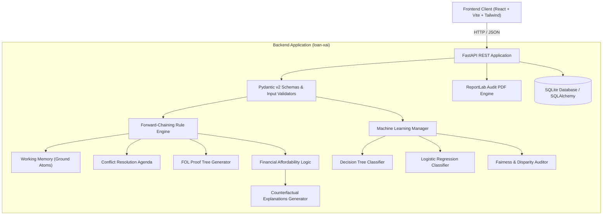

# System Architecture & Technical Design
**Course**: Artificial Intelligence Foundations  
**System**: Explainable Rule-Based Loan Eligibility & Credit Decision System (`loan-xai`)

---

## 1. High-Level Architectural Overview

The `loan-xai` architecture employs a clean separation of concerns across a modern decoupled stack:
- **Presentation Tier**: React 18 single-page application built with Vite and Tailwind CSS. All business logic is isolated in the backend; the UI serves purely as an accessible, interactive display and dashboard.
- **Inference & Application Tier**: Python FastAPI service exposing typed REST endpoints (validated through Pydantic v2).
- **Core Expert System Engine**:
  - **Working Memory**: In-memory knowledge store of asserted ground atomic facts.
  - **Pattern Matcher**: Evaluates condition predicates against working memory.
  - **Conflict Set & Agenda**: Resolves multiple matching rules through hard-knockout priority, salience, condition specificity, and deterministic tie-breaking with refraction.
  - **First-Order Logic (FOL) Engine**: Constructing Horn-clause proofs with unification, variable substitution, and negation-as-failure.
- **Machine Learning & Fairness Auditor**:
  - Independent synthetic economic generator generating ground truth repayment via logistic structural equations.
  - Scikit-learn Decision Tree surrogate and regularized Logistic Regression.
  - Statistical parity and disparate impact auditor computing EEOC 4/5ths benchmarks and proxy feature leakage.
- **Persistence Tier**: SQLite database via SQLAlchemy ORM recording complete applications, decisions, and step-by-step execution traces.

---

## 2. Component Design & Responsibility Mapping

| Layer / Component | Module Path | Responsibilities |
| :--- | :--- | :--- |
| **Declarative Rules** | `backend/app/config/rules.yaml` | Human-readable and machine-executable rule declarations with priority, premises, actions, and FOL syntax. |
| **Underwriting Thresholds** | `backend/app/config/thresholds.yaml` | Version-controlled financial caps (DTI 40%, credit score 750/550, rate bands, income caps). |
| **Financial Mathematics** | `backend/app/logic/financial.py` | DTI ratios, max EMI disposable headroom, annuity supportable principal sizing, counterfactual delta math. |
| **FOL Proof Engine** | `backend/app/logic/fol.py` | Ground atomic formulas, substitution unification, Horn clause derivation, negation-as-failure, proof trees. |
| **Inference Engine** | `backend/app/rule_engine/engine.py` | Forward chaining to fixpoint, conflict resolution (knockout > salience > specificity > tie-break), refraction, execution trace logging. |
| **Synthetic Generator** | `backend/app/ml/data.py` | Seeded generation (6,000 samples) with independent logistic repayment ground truth and quarantined protected demographics. |
| **ML Models & Benchmarks** | `backend/app/ml/models.py` | Decision Tree (`max_depth=4`), Logistic Regression, agreement analysis (Cohen's Kappa), 9 edge-case suite evaluation. |
| **Fairness Auditor** | `backend/app/fairness/audit.py` | Computes Disparate Impact Ratio (DIR), Statistical Parity Difference (SPD), Equal Opportunity Difference (EOD), proxy analysis, automated narrative. |
| **Database ORM** | `backend/app/db/` | SQLite schema with applications, decisions, rule execution step traces, ML benchmark runs, and fairness reports. |
| **REST API** | `backend/app/api/endpoints.py` | Endpoints for evaluation, dashboard stats, application history, model retraining, CSV export, and PDF streaming. |
| **PDF Audit Report** | `backend/app/logic/pdf_report.py` | Generates official credit audit memorandum with full FOL proof and adverse action notices using ReportLab. |
