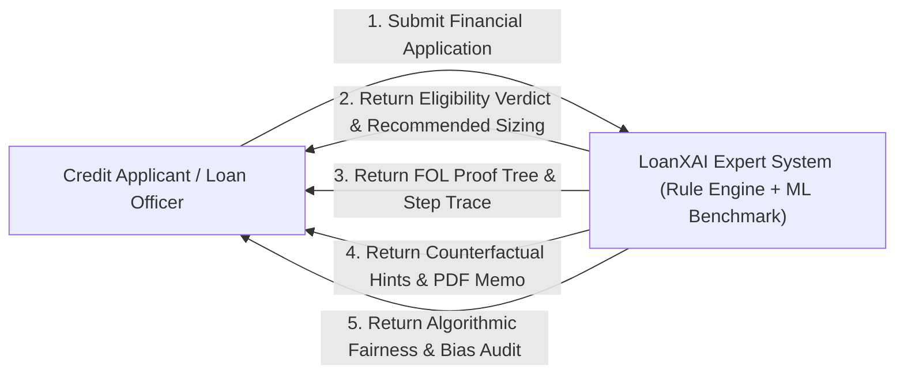
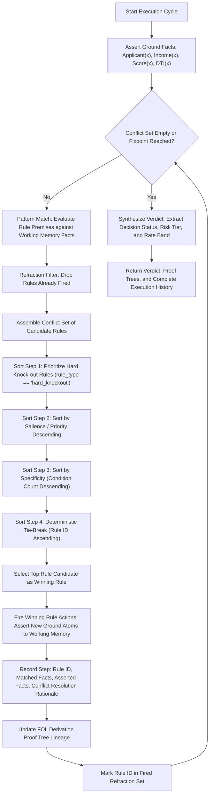

# Data Flow Diagrams (DFD)
**Course**: Artificial Intelligence Foundations  
**System**: Explainable Rule-Based Loan Eligibility & Credit Decision System (`loan-xai`)

---

## 1. DFD Level 0: Context Diagram

The Level 0 Context Diagram depicts the entire LoanXAI system as a single boundary interacting with external entities: the Credit Applicant / Loan Officer and Credit Bureau Data Sources.

---

## 2. DFD Level 1: Subsystem Data Flow

Level 1 decomposes the system into its primary computational modules: Input Validation, Production Rule Engine, Financial Sizing, ML Benchmarking, and Audit Logging.

```mermaid
graph TD
    User["Applicant / Underwriter"] -->|Raw JSON Payload| P1["1.0 Input Validation & Warning Detection"]
    
    P1 -->|Validated Clean Inputs| P2["2.0 Working Memory Initialization"]
    P1 -->|Input Warnings Notice| P5["5.0 Response Synthesizer"]
    
    subgraph "Rule Engine Core"
        P2 -->|Assert Ground Atoms| WM[("Working Memory Facts")]
        WM -->|Match Premises| P3["3.0 Forward-Chaining Pattern Matcher"]
        RulesYAML[("config/rules.yaml")] --> P3
        P3 -->|Candidate Rules| P4["4.0 Conflict Resolution Agenda"]
        P4 -->|Winning Rule Execution| WM
        P4 -->|Execution Step History| TraceDB[("Execution Trace")]
        WM -->|Final Derived Atoms| P5
    end
    
    subgraph "Financial Affordability"
        ThresholdsYAML[("config/thresholds.yaml")] --> P6["6.0 Sizing & Annuity Calculator"]
        P2 --> P6
        P6 -->|Recommended Amount & Bands| P5
        P6 -->|Counterfactual Delta Bounds| P5
    end
    
    subgraph "Statistical Machine Learning"
        P2 -->|Non-protected Features| P7["7.0 ML Classifier Benchmark"]
        P7 -->|Decision Tree & Logistic Preds| P5
    end
    
    P5 -->|Complete Audit Record| SQLite[("SQLite Database")]
    P5 -->|Interactive Decision Response| User
```

---

## 3. DFD Level 2: Rule Engine Internal Forward-Chaining Cycle

Level 2 details the exact iterative forward-chaining fixpoint inference loop and conflict resolution pipeline.

