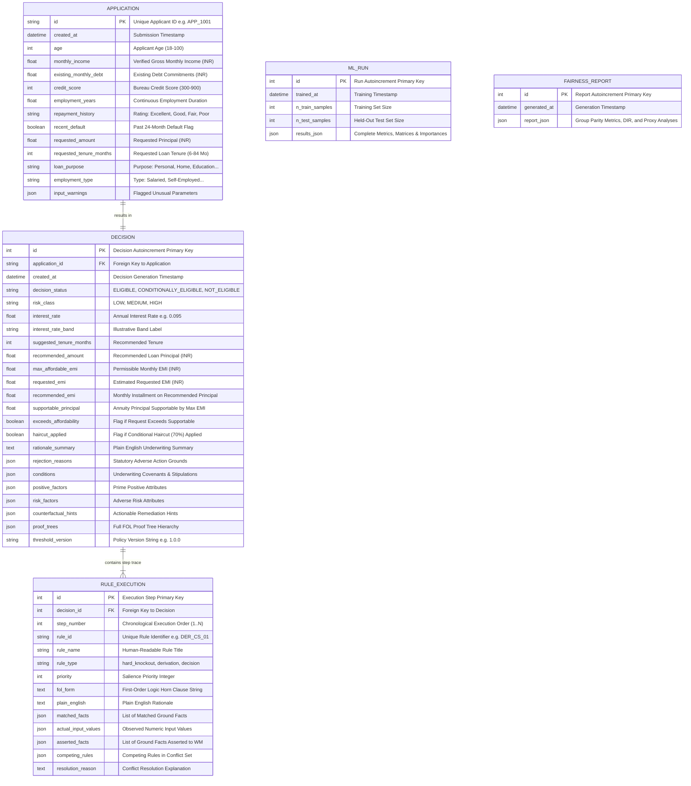

# Entity-Relationship Diagram (ERD)
**Course**: Artificial Intelligence Foundations  
**System**: Explainable Rule-Based Loan Eligibility & Credit Decision System (`loan-xai`)

---

## Database Entity-Relationship Model (Mermaid)

