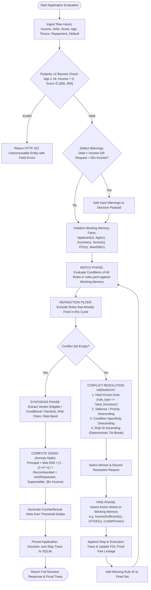

# Forward-Chaining Inference & Conflict Resolution Flowchart
**Course**: Artificial Intelligence Foundations  
**System**: Explainable Rule-Based Loan Eligibility & Credit Decision System (`loan-xai`)

---

## Complete Forward-Chaining Inference Flowchart

