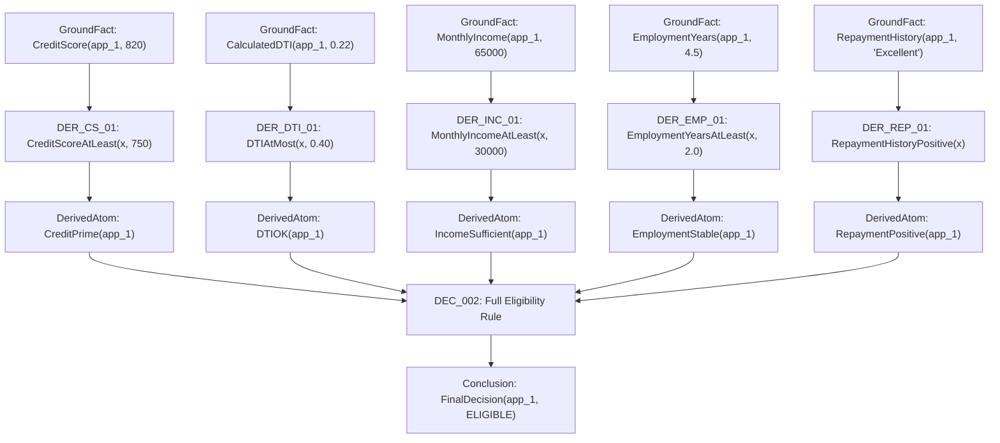

# First-Order Logic (FOL) Specifications & Proof Semantics
**Course**: Artificial Intelligence Foundations  
**System**: Explainable Rule-Based Loan Eligibility & Credit Decision System (`loan-xai`)

---

## 1. Formal Logical Framework

The expert system's knowledge base is expressed in **First-Order Predicate Logic (FOL)** constrained to **Definite Horn Clauses**.

### 1.1 Predicates
- $\text{Applicant}(x)$: $x$ is a registered credit applicant.
- $\text{AgeLessThan}(x, t)$: Age of applicant $x$ is strictly less than threshold $t \in \mathbb{N}$.
- $\text{MonthlyIncomeAtLeast}(x, t)$: Gross monthly income of $x$ is $\ge t \in \mathbb{R}^+$.
- $\text{DTIAtMost}(x, r)$: Debt-to-Income ratio of $x$ is $\le r \in [0, 1]$.
- $\text{CreditScoreAtLeast}(x, s)$: Credit score of $x$ is $\ge s \in [300, 900]$.
- $\text{EmploymentYearsAtLeast}(x, y)$: Continuous employment of $x$ is $\ge y \in \mathbb{R}^+$.
- $\text{RepaymentPositive}(x)$: Historical repayment rating of $x$ is Good or Excellent.
- $\text{RecentDefaultOnRecord}(x)$: Applicant $x$ has an active default on record within 24 months.
- $\text{HardKnockout}(x, r)$: Applicant $x$ is disqualified by statutory/regulatory knockout reason $r$.
- $\text{RiskLevel}(x, l)$: Risk tier classification of applicant $x$, where $l \in \{\text{LOW}, \text{MEDIUM}, \text{HIGH}\}$.
- $\text{FinalDecision}(x, d)$: Final underwriting outcome, where $d \in \{\text{ELIGIBLE}, \text{CONDITIONALLY\_ELIGIBLE}, \text{NOT\_ELIGIBLE}\}$.

---

## 2. Horn Clause Representation

A definite Horn clause is a disjunction of literals with **at most one positive literal**:
$$\neg P_1(x) \lor \neg P_2(x) \lor \dots \lor \neg P_k(x) \lor C(x)$$

Expressed in standard logical implication format:
$$\forall x: P_1(x) \land P_2(x) \land \dots \land P_k(x) \to C(x)$$

Where:
- $P_i(x)$ are the premise body atoms (antecedents).
- $C(x)$ is the conclusion head atom (consequent).

### Example Horn Clause (Affordability & Prime Eligibility)
$$\forall x: \text{Applicant}(x) \land \text{IncomeSufficient}(x) \land \text{CreditPrime}(x) \land \text{DTIOK}(x) \land \text{EmploymentStable}(x) \land \text{RepaymentPositive}(x) \land \sim\text{HardKnockout}(x) \to \text{FinalDecision}(x, \text{ELIGIBLE})$$

---

## 3. Negation as Failure (NAF)

The system operates under the **Closed-World Assumption (CWA)** with **Negation as Failure (NAF)**:
$$\frac{KB \not\vdash P(t)}{\sim P(t)}$$

If an atomic proposition $P(t)$ cannot be derived or proven from the working memory facts, its negation $\sim P(t)$ is assumed to hold. This is used in:
- $\sim\text{HardKnockout}(x)$: Verified when no hard knockout atoms exist in working memory.
- $\sim\text{RecentDefaultOnRecord}(x)$: Verified when no bureau default flag is asserted.

---

## 4. Unification & Substitution

Variables in rule clauses (typically $x$) are bound to ground applicant constants ($a = \text{APP\_1001}$) via the substitution mapping:
$$\theta = \{x \mapsto \text{APP\_1001}\}$$

Under this substitution:
$$P(x)\theta = P(\text{APP\_1001})$$

All facts in working memory are **ground atoms** containing no free variables.

---

## 5. Derivation (Proof) Trees

Every conclusion derived by the engine maintains an explicit lineage to the ground facts and intermediate Horn clauses that established it.

