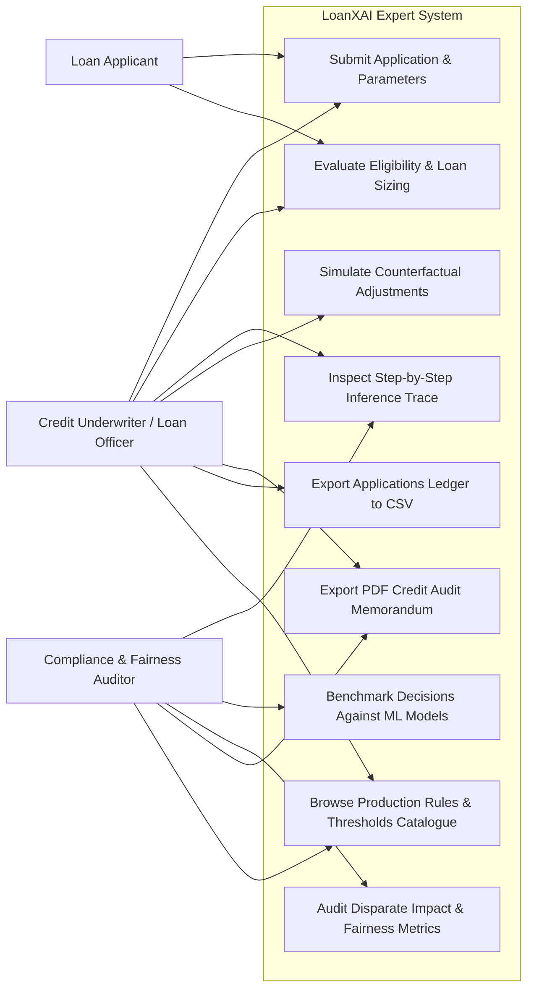

# Use Case Specifications & Diagrams
**Course**: Artificial Intelligence Foundations  
**System**: Explainable Rule-Based Loan Eligibility & Credit Decision System (`loan-xai`)

---

## 1. Use Case Diagram (Mermaid)

---

## 2. Key Use Case Descriptions

### UC-1: Evaluate Credit Application
- **Primary Actor**: Credit Underwriter / Loan Applicant.
- **Preconditions**: Applicant inputs non-protected financial data (income, debt, credit score, employment tenure, repayment rating, loan request, tenure).
- **Main Flow**:
  1. User submits data or selects a pre-configured scenario.
  2. System validates bounds (Pydantic v2); flags unusual-but-valid inputs (e.g. debt > income).
  3. Rule engine initializes working memory and executes forward chaining to fixpoint.
  4. System determines status (`ELIGIBLE`, `CONDITIONALLY_ELIGIBLE`, `NOT_ELIGIBLE`), risk tier, rate band, and supportable annuity principal.
  5. System generates counterfactual hints and records full execution trace in SQLite.
- **Postconditions**: Decision, proof trees, and comparison metrics rendered on screen.

### UC-2: Inspect FOL Proof Tree & Execution Trace
- **Primary Actor**: Compliance Auditor / Underwriter.
- **Preconditions**: Application has been evaluated.
- **Main Flow**:
  1. User navigates to Inference Trace page.
  2. System displays chronological firing order with conflict resolution rationales.
  3. System renders interactive First-Order Logic proof trees showing ground facts supporting each intermediate derivation.

### UC-3: Algorithmic Fairness & Disparity Audit
- **Primary Actor**: Compliance Officer / AI Ethics Researcher.
- **Preconditions**: ML models trained on synthetic audit dataset with quarantined protected demographic attributes (gender, age bracket, regional setting).
- **Main Flow**:
  1. User selects demographic attribute and target system.
  2. System plots Disparate Impact Ratios against EEOC 0.80 benchmark line.
  3. System displays subgroup tables with approval rates, false positive/negative rates, and equal opportunity differences.
  4. System flags proxy feature leakage and auto-generates governance recommendations.
